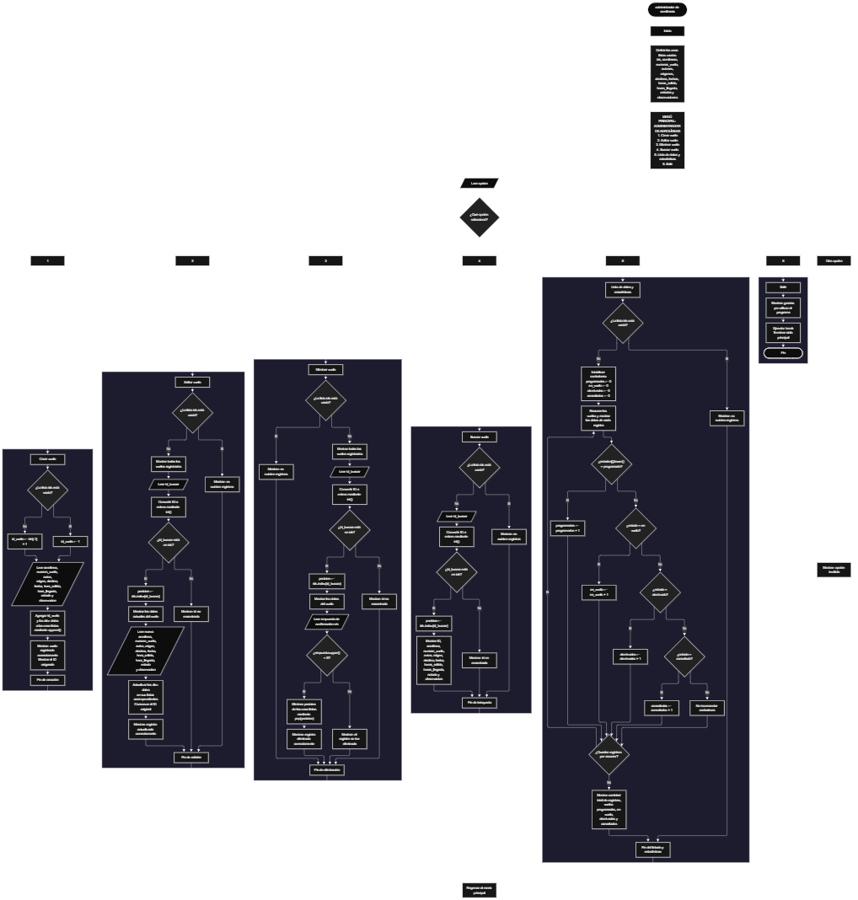

 

Este proyecto, llamado <b>administrador de aerolíneas</b>, fue desarrollado en <b>python</b> como un ejercicio práctico para fortalecer la lógica de programación mediante la creación de un sistema de administración de vuelos desde la consola. El programa cuenta con un menú principal de seis opciones que permite <b>crear, editar, eliminar, buscar y listar vuelos</b>, además de consultar estadísticas relacionadas con sus estados. Cada vuelo almacena información como el nombre de la aerolínea, el número de vuelo, el modelo del avión, las ciudades de origen y destino, la fecha, las horas de salida y llegada, el estado y las observaciones. Para organizar los registros, se utilizan once listas paralelas que mantienen los datos relacionados mediante un identificador numérico. Durante su desarrollo se aplicaron conceptos fundamentales de programación, como variables, listas, estructuras condicionales, ciclos repetitivos, estructuras de selección y operaciones para buscar, modificar y eliminar registros. Este proyecto permite poner en práctica los conocimientos adquiridos en Python y sirve como base para desarrollar sistemas de administración más completos utilizando otros lenguajes y tecnologías.

<h2 align="center">⚙️ Funcionamiento del menú principal</h2>

### ➕ Crear vuelo

La opción <b>1) crear vuelo</b> permite registrar un nuevo vuelo en el sistema. Antes de comenzar, el programa comprueba si la lista <b>ids</b> está vacía mediante la condición <b>len(ids) == 0</b>. Si no existen registros, asigna el identificador <b>1</b> mediante la variable <b>id_vuelo</b>. En caso contrario, genera el siguiente identificador sumando uno al último elemento de la lista mediante la expresión <b>ids[-1] + 1</b>. Después, solicita el <b>nombre de la aerolínea, número de vuelo, modelo del avión, ciudad de origen, ciudad de destino, fecha, hora de salida, hora de llegada, estado y observación</b>. Los datos se almacenan en sus respectivas listas utilizando el método <b>append()</b>, manteniendo la correspondencia entre las posiciones de los registros. Finalmente, muestra el mensaje <b>"vuelo registrado correctamente."</b> e informa el ID asignado al nuevo vuelo.

### ✏️ Editar vuelo

La opción <b>2) editar vuelo</b> permite modificar la información de un vuelo registrado. Primero, el programa comprueba si la lista <b>ids</b> está vacía. Si no existen registros, muestra el mensaje <b>"no existen registros."</b>. En caso contrario, presenta una lista con la información de todos los vuelos y solicita el identificador del registro que se desea editar. La entrada se convierte a un número entero mediante <b>int()</b> y se comprueba su existencia utilizando la condición <b>id_buscar in ids</b>. Si el ID existe, obtiene su posición con <b>ids.index(id_buscar)</b>, muestra los datos actuales y solicita la nueva información de la aerolínea, número de vuelo, avión, origen, destino, fecha, horas de salida y llegada, estado y observación. Los valores se actualizan directamente en las listas correspondientes, conservando el identificador original. Finalmente, muestra el mensaje <b>"registro actualizado correctamente."</b>. Si el ID no existe, presenta el mensaje <b>"id no encontrada."</b>.

### 🗑️ Eliminar vuelo

La opción <b>3) eliminar vuelo</b> permite eliminar un registro de vuelo mediante su identificador. Primero, el programa comprueba si existen registros almacenados. Si la lista <b>ids</b> está vacía, muestra el mensaje <b>"no existen registros."</b>. Si hay vuelos disponibles, presenta sus datos y solicita el ID del registro que se desea eliminar. Después, comprueba si el identificador existe y obtiene su posición mediante <b>ids.index(id_buscar)</b>. Si lo encuentra, muestra los datos del vuelo y solicita confirmación mediante la pregunta <b>"¿desea eliminar este registro? (s/n):"</b>. La respuesta se convierte a mayúsculas con <b>upper()</b> para comprobar si es igual a <b>"S"</b>. Si se confirma la eliminación, utiliza <b>pop(posicion)</b> en las once listas para retirar los datos correspondientes al mismo vuelo. Finalmente, muestra el mensaje <b>"registro eliminado correctamente."</b>. Si el usuario no confirma la operación, informa que el registro no fue eliminado. Si el ID no existe, muestra el mensaje <b>"id no encontrada."</b>.

### 🔎 Buscar vuelo

La opción <b>4) buscar vuelo</b> permite localizar un registro mediante su identificador. Antes de realizar la búsqueda, el programa comprueba si existen vuelos almacenados. Si no hay registros, presenta el mensaje <b>"no existen registros."</b>. En caso contrario, solicita el ID del vuelo y convierte el valor introducido a un número entero mediante <b>int()</b>. Después, utiliza la condición <b>id_buscar in ids</b> para comprobar si el identificador está registrado. Si existe, obtiene la posición correspondiente con <b>ids.index(id_buscar)</b> y muestra todos los datos del vuelo, incluyendo el ID, la aerolínea, el número de vuelo, el avión, el origen, el destino, la fecha, las horas de salida y llegada, el estado y las observaciones. Si no encuentra el identificador, muestra el mensaje <b>"id no encontrada."</b>. Esta función facilita consultar un vuelo específico sin necesidad de revisar manualmente todos los registros.

### 📋 Lista de datos y estadísticas

La opción <b>5) lista de datos</b> permite visualizar todos los vuelos registrados y obtener estadísticas sobre sus estados. Primero, el programa comprueba si la lista <b>ids</b> está vacía. Si no existen registros, muestra el mensaje <b>"no existen registros."</b>. En caso contrario, inicializa cuatro contadores: <b>programados, en_vuelo, aterrizados y cancelados</b>, todos con el valor <b>0</b>. Después, utiliza un ciclo <b>for</b> para recorrer las listas y mostrar la información de cada vuelo. Durante el recorrido, compara el estado almacenado en <b>estados[i]</b> con las categorías <b>"programado", "en vuelo", "aterrizado" y "cancelado"</b>, utilizando el método <b>lower()</b> para ignorar las diferencias entre mayúsculas y minúsculas. Cuando encuentra una coincidencia, incrementa el contador correspondiente. Al finalizar, presenta las estadísticas del administrador de aerolíneas: la cantidad total de registros, los vuelos programados, los vuelos en vuelo, los vuelos aterrizados y los vuelos cancelados. Los registros con estados diferentes de esas cuatro categorías aparecen en el listado, pero no se incluyen en ninguno de los contadores.

### 🚪 Salir del menú principal

La opción <b>6) salir</b> permite finalizar la ejecución del programa. Cuando el usuario selecciona esta opción, el sistema muestra el mensaje <b>"gracias por utilizar el programa."</b> y ejecuta la instrucción <b>break</b>, que interrumpe el ciclo <b>while True</b> del menú principal. De esta manera, el programa deja de solicitar opciones y termina su ejecución. Si el usuario introduce un valor que no coincide con las opciones disponibles del menú, se ejecuta el bloque <b>else</b>, que muestra el mensaje <b>"opción inválida."</b> y permite continuar utilizando el programa.

<h2 align="center">🧠 Temas aplicados en el proyecto</h2>

### 📦 Variables

En este proyecto se utilizan variables para controlar la opción seleccionada en el menú, generar identificadores, almacenar temporalmente los datos introducidos por el usuario, localizar los registros y contar los vuelos según su estado. Cada variable cumple una función específica dentro de las operaciones de administración, permitiendo organizar el procesamiento de los datos y obtener las estadísticas correspondientes.

🔢 **Opcion:** Almacena la opción seleccionada por el usuario en el menú principal.

🆔 **Id_vuelo:** Almacena el identificador asignado al vuelo durante su registro.

🔎 **Id_buscar:** Guarda el identificador introducido por el usuario para buscar, editar o eliminar un vuelo.

📍 **Posicion:** Indica el índice del registro localizado dentro de las listas.

📝 **Aerolinea, numero_vuelo, avion, origen, destino, fecha, hora_salida, hora_llegada, estado y observacion:** Almacenan temporalmente los datos introducidos durante la creación de un vuelo.

📊 **Programados:** Cuenta los vuelos cuyo estado es igual a <b>"programado"</b>.

✈️ **En_vuelo:** Cuenta los vuelos cuyo estado es igual a <b>"en vuelo"</b>.

🛬 **Aterrizados:** Cuenta los vuelos cuyo estado es igual a <b>"aterrizado"</b>.

❌ **Cancelados:** Cuenta los vuelos cuyo estado es igual a <b>"cancelado"</b>.

🔄 **I:** Funciona como índice para recorrer las listas y acceder a los datos de cada vuelo.

### 🗃️ Listas

En este proyecto se utilizan once listas paralelas para almacenar y organizar la información de los vuelos. Cada lista contiene un tipo de dato y utiliza el mismo índice para relacionarlo con los demás datos del registro. Por ejemplo, la información del primer vuelo se encuentra en la posición <b>0</b> de cada lista, mientras que la información del segundo vuelo se encuentra en la posición <b>1</b>. Esta organización permite recorrer, consultar, modificar y eliminar los registros manteniendo la correspondencia entre sus datos.

🆔 **Ids:** Almacena los identificadores de los vuelos registrados.

🏢 **Aerolineas:** Almacena los nombres de las aerolíneas.

🔢 **Numeros_vuelo:** Almacena los números de vuelo.

✈️ **Aviones:** Almacena los modelos de los aviones.

🛫 **Origenes:** Almacena las ciudades de origen.

🛬 **Destinos:** Almacena las ciudades de destino.

📅 **Fechas:** Almacena las fechas de los vuelos.

🕒 **Horas_salida:** Almacena las horas de salida de los vuelos.

🕓 **Horas_llegada:** Almacena las horas de llegada de los vuelos.

📊 **Estados:** Almacena los estados de los vuelos.

📝 **Observaciones:** Almacena las observaciones adicionales de cada registro.

### 🔀 Estructuras condicionales

En este proyecto se utilizan las estructuras <b>if, elif y else</b> para controlar las opciones del menú, comprobar si existen registros, verificar si un identificador está almacenado y determinar si se debe confirmar una eliminación. También se utilizan condiciones para clasificar los vuelos según sus estados y actualizar los contadores de las estadísticas. Estas estructuras permiten que el programa ejecute diferentes instrucciones dependiendo de los datos introducidos y de los resultados de cada comprobación.

### 🔄 Estructuras repetitivas

En este proyecto se utilizan los ciclos <b>while</b> y <b>for</b>. El ciclo <b>while True</b> mantiene activo el menú principal hasta que el usuario selecciona la opción de salida y se ejecuta <b>break</b>. Por otro lado, los ciclos <b>for</b> recorren las listas para mostrar los registros durante las operaciones de edición y eliminación, así como para calcular las estadísticas de los vuelos. El uso de estos ciclos permite procesar una cantidad variable de registros sin tener que escribir instrucciones independientes para cada vuelo.

### 🎯 Estructuras de selección

El programa utiliza una cadena de condiciones <b>if, elif y else</b> para determinar qué operación debe ejecutarse según el valor almacenado en <b>opcion</b>. Las seis opciones del menú corresponden a crear, editar, eliminar, buscar, listar datos y salir. Cada alternativa contiene las instrucciones necesarias para realizar la operación seleccionada. Si el usuario introduce un valor diferente de los disponibles, el bloque <b>else</b> muestra el mensaje <b>"opción inválida."</b>.

### 🔍 Búsqueda de registros

La búsqueda de vuelos se realiza mediante los métodos y operadores <b>in</b> e <b>index()</b>. Primero, el programa comprueba si el identificador introducido se encuentra en la lista <b>ids</b>. Si existe, utiliza <b>ids.index(id_buscar)</b> para obtener la posición del registro. Esta posición permite acceder a la información relacionada en las demás listas y utilizarla en las operaciones de consulta, edición y eliminación. El identificador funciona como referencia para localizar cada vuelo dentro de los datos almacenados.

### 🛠️ Métodos de listas

El programa utiliza diferentes operaciones de listas para administrar los registros. El método <b>append()</b> agrega los datos de un nuevo vuelo al final de cada lista. El método <b>pop(posicion)</b> elimina los elementos que corresponden al vuelo seleccionado. El método <b>index()</b> localiza la posición de un identificador y el operador <b>in</b> comprueba si ese identificador existe. Estas operaciones permiten implementar las funciones principales de administración de vuelos mediante las listas de Python.

### 📊 Contadores y estadísticas

Para obtener las estadísticas, el programa inicializa cuatro contadores con el valor <b>0</b> y recorre la lista de estados. En cada posición, compara el texto almacenado con las cuatro categorías contempladas y aumenta el contador correspondiente cuando existe una coincidencia. El método <b>lower()</b> permite realizar estas comparaciones sin distinguir entre mayúsculas y minúsculas. Al terminar el recorrido, el programa muestra la cantidad total de vuelos y el número de registros de cada categoría reconocida.

### 🔠 Manipulación de cadenas

El proyecto utiliza los métodos <b>lower()</b> y <b>upper()</b> para convertir temporalmente textos a minúsculas o mayúsculas durante las comparaciones. El método <b>lower()</b> se aplica al estado de cada vuelo para reconocer las categorías estadísticas aunque se hayan escrito con distintas combinaciones de mayúsculas y minúsculas. Por su parte, <b>upper()</b> se utiliza en la confirmación de la eliminación para aceptar tanto <b>"s"</b> como <b>"S"</b>. Estos métodos facilitan las comprobaciones de texto sin modificar permanentemente los valores almacenados en las listas.

<h2 align="center">¿Cómo se implementaron las operaciones crud en el proyecto?</h2>

Las operaciones <b>crud</b> se implementaron mediante las opciones del menú principal, permitiendo administrar los vuelos registrados. La operación <b>crear</b> corresponde a <b>crear vuelo</b>, donde se solicitan los datos y se almacenan en las once listas; <b>leer</b> se realiza mediante las opciones <b>buscar vuelo</b> y <b>lista de datos</b>, que permiten consultar un registro específico o visualizar todos los vuelos; <b>actualizar</b> corresponde a <b>editar vuelo</b>, donde se modifica la información de un vuelo existente sin cambiar su identificador; y <b>eliminar</b> se realiza mediante la opción <b>eliminar vuelo</b>, que solicita confirmación y retira los datos del registro de todas las listas. Estas operaciones utilizan listas, condiciones, ciclos y métodos de Python para administrar la información durante la ejecución del programa.

<h2 align="center">Diagrama de flujo del proyecto</h2>

<h2 align="center">🛡️ Validaciones del programa</h2>

### 📭 No existen registros

Esta comprobación se utiliza en las opciones de <b>editar, eliminar, buscar y lista de datos</b>. El programa verifica si la lista <b>ids</b> está vacía mediante la condición <b>len(ids) == 0</b>. Si no existen vuelos registrados, muestra el mensaje <b>"no existen registros."</b> y evita continuar con la operación que requiere información almacenada. En la opción de creación, esta misma condición se utiliza para asignar el primer identificador al nuevo vuelo.

### 🔎 Identificador no encontrado

Esta comprobación se utiliza en las operaciones de <b>editar, eliminar y buscar vuelo</b>. El programa verifica si el identificador introducido está presente en la lista <b>ids</b> mediante la condición <b>id_buscar in ids</b>. Si existe, obtiene su posición utilizando <b>ids.index(id_buscar)</b> y continúa con la operación correspondiente. Si no existe, muestra el mensaje <b>"id no encontrada."</b>. Esta comprobación permite evitar que se intente acceder a un registro utilizando un identificador que no está almacenado.

### ❓ Confirmación de eliminación

Antes de eliminar un vuelo, el programa solicita confirmación mediante la entrada <b>respuesta</b>. La condición <b>respuesta.upper() == "S"</b> determina si se ejecuta la eliminación. Si el usuario responde <b>"s"</b> o <b>"S"</b>, se eliminan los datos de las once listas mediante <b>pop(posicion)</b>. Si introduce cualquier otra respuesta, el programa muestra el mensaje <b>"el registro no fue eliminado."</b> y conserva los datos del vuelo.

### 📊 Clasificación de estados

Durante la generación de estadísticas, el programa reconoce los estados <b>"programado", "en vuelo", "aterrizado" y "cancelado"</b>. Para realizar las comparaciones, utiliza <b>estados[i].lower()</b>, lo que permite reconocer esas categorías sin distinguir entre mayúsculas y minúsculas. Sin embargo, el código no valida los estados al registrar o editar un vuelo. Por este motivo, cualquier otro texto puede almacenarse y mostrarse en el listado, aunque no se contabilice dentro de las cuatro categorías estadísticas.

### ⚠️ Conversión de identificadores

Durante las operaciones de edición, eliminación y búsqueda, el programa utiliza <b>int()</b> para convertir el identificador introducido a un número entero. Esta conversión permite compararlo con los identificadores almacenados en la lista <b>ids</b>. Sin embargo, el código no incorpora un bloque <b>try ... except</b> para controlar entradas que no puedan convertirse a entero. Por tanto, si se introduce un texto que no represente un número entero válido, puede producirse un error durante la ejecución.

### ⚠️ Validación de fechas, horas y datos del vuelo

El programa solicita los datos del vuelo mediante <b>input()</b>, pero no incluye comprobaciones específicas para verificar el formato de las fechas, las horas de salida y llegada, los nombres de las ciudades, los números de vuelo o los modelos de los aviones. Tampoco comprueba que la hora de llegada sea posterior a la hora de salida ni restringe los estados a una lista de opciones permitidas. Por ello, los datos se almacenan según los valores introducidos por el usuario, sin validaciones adicionales sobre su formato o coherencia.

### ⚠️ Opción inválida

La estructura de selección del menú incluye un bloque <b>else</b> que muestra el mensaje <b>"opción inválida."</b> cuando el usuario introduce un valor diferente de las opciones <b>1, 2, 3, 4, 5 y 6</b>. Después de mostrar el mensaje, el ciclo principal continúa y vuelve a presentar el menú. Esta comprobación permite mantener el funcionamiento del programa cuando se selecciona una opción no contemplada.

### 💾 Almacenamiento temporal de los datos

Los vuelos se almacenan en listas creadas en la memoria durante la ejecución del programa. El código no utiliza archivos, bases de datos ni mecanismos de persistencia para conservar los registros después de finalizar. Por esta razón, los vuelos registrados se mantienen disponibles mientras el programa continúa ejecutándose, pero se pierden cuando termina la ejecución.

<h2 align="center">🎯 Objetivo del proyecto</h2>

El objetivo principal de este proyecto es fortalecer la <b>lógica de programación</b> mediante el desarrollo de un sistema de administración de vuelos en <b>python</b>. A través de su construcción se busca aplicar los conocimientos adquiridos sobre variables, listas, estructuras condicionales, ciclos repetitivos, estructuras de selección, métodos de listas y manipulación de cadenas, integrándolos para resolver un problema de manera organizada. Además, el proyecto permite comprender cómo registrar, consultar, modificar y eliminar información, así como obtener estadísticas a partir de los estados de los vuelos. De esta manera, establece una base para desarrollar sistemas de administración más completos utilizando otros lenguajes y tecnologías.

